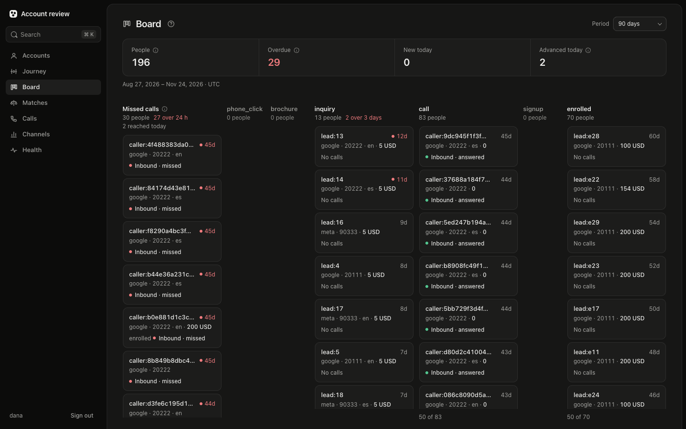
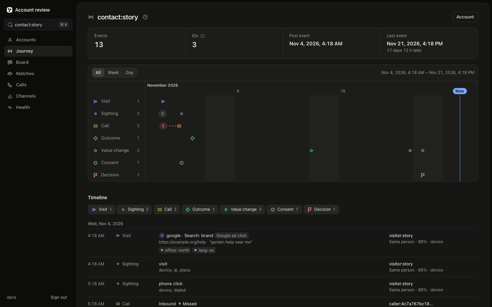
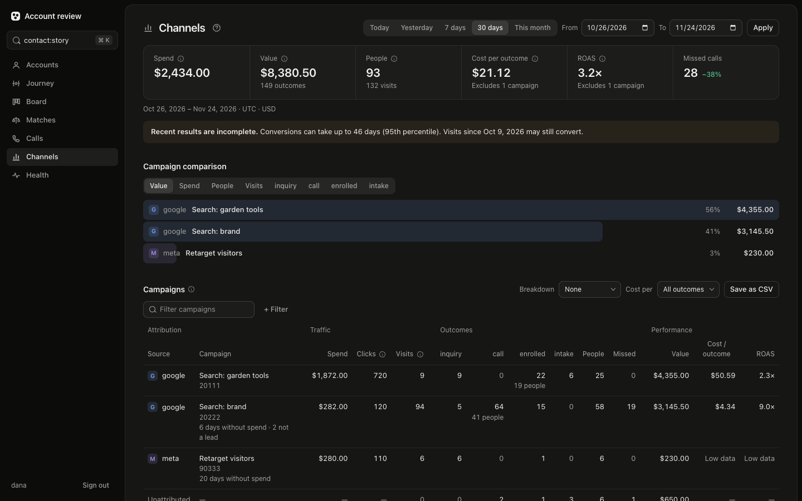
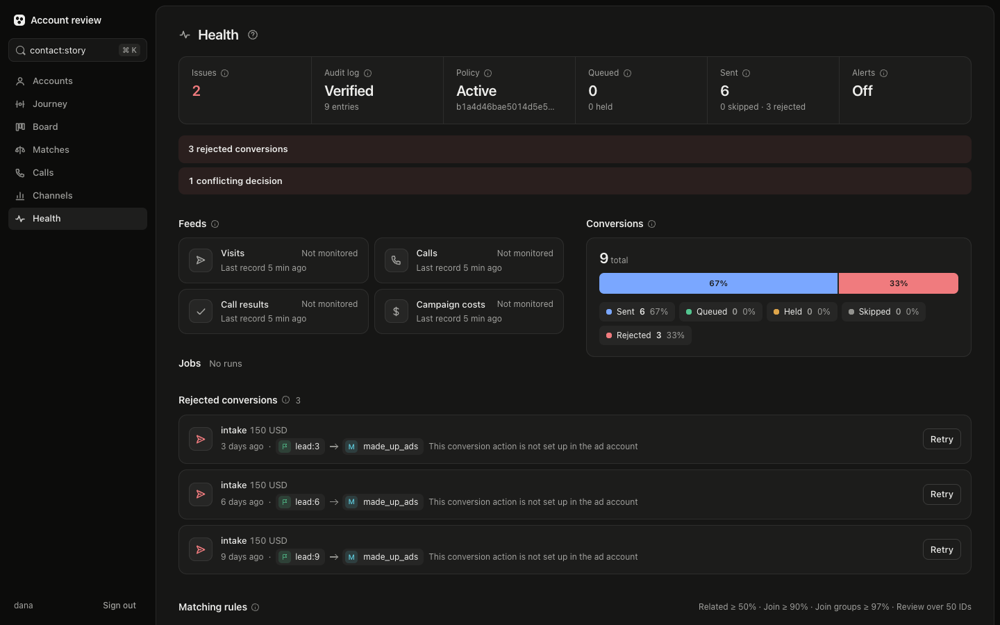
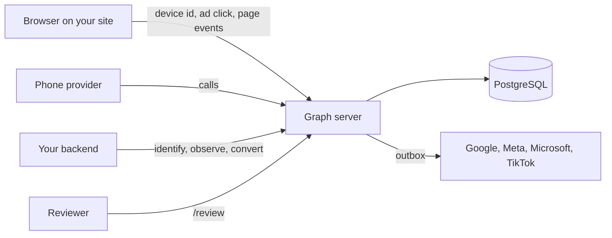

# account-graph

account-graph links the visits, calls, accounts and records that belong to one person, and attributes outcomes to the ads that produced them.

It runs as a server beside your site, phone system and backend. Reviewers work in a built-in screen that shows the evidence behind every match, missed calls awaiting a callback, and the return on each campaign.

| Board | Journey |
| --- | --- |
|  |  |
| **Channels** | **Health** |
|  |  |

Screenshots show sample data.

## Quick start

Requires Node 22.18 or later. Docker is optional and provides PostgreSQL; without it the demo runs in memory.

```sh
git clone https://github.com/pwngh/account-graph && cd account-graph
npm ci && npm run firm
```

This starts a sample law firm with two months of data: the server, a bilingual site, and a presenter page with ten scenes. Press Ctrl-C to stop it and delete its data. See [Demo](docs/demo.md) for a 90-second script.

## Features

| Area | Capability |
| --- | --- |
| Identity | Scored links with the evidence for each, clusters that can be split, and reviewer decisions with an audit log |
| Calls | Call results, missed calls and callbacks, tap-to-call matching, and optional tracking numbers |
| Attribution | Spend, outcomes, cost per outcome and ROAS by campaign, with breakdowns by office, language, hour or weekday |
| Conversions | An outbox for Google, Meta, Microsoft and TikTok with batching, retries and restatements |
| Reviewer screen | Accounts, Journey, Board, Matches, Calls, Channels and Health |
| Privacy | Hashed emails, phones and addresses, consent history, deletion and pruning |
| Operations | Feed monitoring, webhook alerts, opening hours, PostgreSQL or in-memory storage, no runtime dependencies except `pg` for PostgreSQL |

The server sends data to the ad platforms and webhooks you configure. It places no calls, assigns no work and sends no messages to customers.

## How it works



1. The browser script reports a device id, the ad click and page events.
2. Your phone provider and backend report calls, sign-ins, outcomes and costs.
3. The server links identifiers into people and attributes outcomes to visits.
4. The outbox sends conversions to the configured ad platforms.

Your backend names the account at sign-in. The browser reports only its own device id.

## Installation

Start the server and its database with your own secrets. Generate each one with `openssl rand -hex 32`.

```sh
export GRAPH_TOKEN=…             # your backend sends the same one
ORIGINS=https://www.example.org REVIEW_TOKENS='{"dana":"…"}' LINK_SECRET=… docker compose up --build
```

`ORIGINS` lists the sites allowed to report. [Operations](docs/operations.md) covers every setting.

Add the script to each page:

```html
<script type="module" src="https://graph.example.org/collect.js"></script>
```

Identify the person when they sign in or sign up:

```sh
curl -X POST https://graph.example.org/identify \
  -H "authorization: Bearer $GRAPH_TOKEN" \
  -d '{"subject":"account:42","event":"signup","device":"9f3c…","email":"pat@example.org"}'
```

The server normalizes and hashes the email, phone and postal address. `device` is the `ag_device` cookie set by the script. The response lists the subjects whose cluster changed.

### Example site

```sh
docker compose up --build        # the server on :8080, and its database
node examples/site.ts            # in a second terminal: an example site on :3000
```

1. Open <http://localhost:3000/?gclid=demo-click&utm_id=20111> and sign up with any email address.
2. The page shows the attributed ad click and its confidence, 98%.
3. Open <http://localhost:8080/review>, sign in with the token `change-me-review-token`, and open the account. **Channels** shows the signup under its campaign.

To use another port, run `GRAPH_PORT=8090 docker compose up --build` and `GRAPH_URL=http://localhost:8090 node examples/site.ts`.

## Documentation

**Run**

- [Operations](docs/operations.md): setup, Docker, the script tag, tokens, monitoring and environment variables
- [Providers](docs/providers.md): credentials for Fingerprint, MaxMind, Google, Meta, Microsoft, TikTok, Twilio and Smarty
- [HTTP API](docs/http.md): routes, authentication and responses
- [Privacy](docs/privacy.md): stored data, data sent, deletion and consent

**Use**

- [Campaign report](docs/report.md): costs, outcomes, attribution and breakdowns
- [Events and calls](docs/calls.md): page events, call results, callbacks and tracking numbers
- [Identify](docs/identify.md): reporting who a person is, hosted forms and filters
- [Signed links](docs/links.md): personal links and cross-site visitors

**Extend**

- [Matching](docs/deciding.md): scores, weights, clusters and policy
- [Presets](docs/presets.md): a policy for contacts entered by staff
- [Library](docs/library.md): using the graph from Node
- [Changelog](CHANGELOG.md)

## Concepts

| Term | Definition |
| --- | --- |
| Subject | Anything with an identity, such as `account:42` or `visitor:9f3c`. The reviewer screen calls it an ID. |
| Identifier | Something a subject was seen with, written `kind:value`, such as `device:9f3c`, `email:…` or `ip:203.0.113.9` |
| Sighting | A record of a subject with an identifier at a time. All other data is derived from sightings. |
| Link | Two subjects that share identifiers, with a score from 0 to 1 and the evidence for it |
| Cluster | The subjects treated as one person |
| Visit (`touch`) | An arrival from an ad click or a campaign |
| Outcome | An event you count, such as an inquiry, a signup or a sale |
| Conversion | An outcome sent to an ad platform |
| Decision | A reviewer action: join, separate, or ignore an identifier |

Each shared identifier contributes evidence: the weight of its kind, reduced by how many subjects share it and by the time between sightings. Evidence combines as `1 − Π(1 − evidence)`. By default, pairs at 0.9 can join and pairs at 0.5 are related. Clustering rules can hold a strong pair apart: a separation, or a single weak link between two groups. See [Matching](docs/deciding.md).

## Performance

Measured on an Apple M1 Max with Node 22 and synthetic data. PostgreSQL 16 ran in Docker on the same machine with two processors and default settings, including `fsync`. Run `DATABASE_URL=postgres://… npm run bench` to measure your own hardware, or omit the variable to measure the memory store.

20,000 accounts:

| Store | One at a time | In batches of 100 | Through the write queue | `links()` |
| --- | --- | --- | --- | --- |
| Memory | 28,700 observations/s | 13,800/s | 16,900/s | 0.02 ms |
| PostgreSQL | 183 observations/s | 1,900/s | 3,600/s | 2.7 ms |

PostgreSQL writes are serialized by an advisory lock. The write queue combines concurrent writes into one transaction.

Large graphs, five edges per account, with `DATABASE_URL=postgres://… npm run bench -- scale 1000000 5000000 10000000`. Cells show time and peak memory:

| Edges | On disk | `rebuild` | `verify` | `asOf` | Observation, `links()` |
| --- | --- | --- | --- | --- | --- |
| 1 million | 420 MB | 7 s, 159 MB | 6 s, 150 MB | 20 s, 1.4 GB | 6.6 ms, 2.3 ms |
| 5 million | 2.1 GB | 45 s, 198 MB | 40 s, 206 MB | 156 s, 3.8 GB | 8.1 ms, 2.9 ms |
| 10 million | 4.3 GB | 94 s, 291 MB | 85 s, 402 MB | out of memory | 10.7 ms, 3.7 ms |

The last column is the median of 300 sequential runs. Other tests used the database during the two larger runs, so those times are upper estimates.

## Tools

| Command | Purpose |
| --- | --- |
| `npm run firm` | Sample firm with a presenter page |
| `npm run review` | Reviewer screen with sample data (`tools/review-demo.ts`) |
| `examples/site.ts` | Two-page site with the script tag and a signup form |
| `tools/browser-check.ts` | Runs `collect`, the server and the outbox against a browser |
| `npm run live-check` | Calls each provider endpoint and prints its response (`tools/live-check.ts`) |
| `tools/replay.ts` | Replays an export of past traffic and compares attribution |
| `tools/labels.ts` | Measures matching against a CSV of checked pairs |
| `tools/costs.ts` | Sends a CSV of campaign costs to a server |
| `tools/export.ts` | Writes edges, flows or cluster labels as CSV |

## Verification

- The shared test suite runs on the memory store and PostgreSQL 16, locally and in CI. It includes a fuzz test of observations, decisions, deletions and transfers, and six concurrent outbox workers.
- The Docker image, the example site, ad click attribution, signed links, cross-site visitors and tap-to-call matching were exercised end to end in Chrome.
- The reviewer screen and the `HttpOnly` device cookie were exercised in Chrome under their production headers.
- A database created before an upgrade was upgraded by starting the server.
- The hardware id was exercised on macOS and Linux.
- The endpoints of Fingerprint, MaxMind, Google (token service, Data Manager, Ads reporting), Meta (conversions and cost reports), Microsoft (Advertising and token service), TikTok, Twilio Lookup and Smarty each returned the expected response to an invalid key.
- The Twilio signature check reproduces the example in Twilio's webhook security documentation.

## Limitations

**Untested**

- Requests with live provider credentials: Fingerprint and MaxMind lookups, token exchange, conversion uploads, cost reports, Twilio line lookup and Smarty address checks. Run `npm run live-check` with your keys.
- Incoming Twilio calls and delivery to a live alert webhook.
- TikTok is excluded from `npm run live-check`, because any call records an event.
- The two Fingerprint browser loaders, the Windows hardware id, and the server-set cookie in Safari.
- Microsoft does not document email normalization. The server lowercases and trims.

**Matching**

- Kinds count as independent evidence unless the policy groups them. The default policy has no groups.
- Matches covers subjects in the newest 10,000 sightings.
- Multiple separations in one component are resolved one at a time, which can cut more links than necessary.
- Separations from your own systems are applied as received. They do not replace a conflict check.
- Subject search matches the start of an id and reads the subject table.
- Signed links identify the recipient. A forwarded link can link another browser to that person. See [Signed links](docs/links.md).
- Postal address checks cover the United States.
- Names corroborate other evidence, and only under a policy that uses them.

**Calls**

- Without call results, a call is counted by its length, which time in a queue can reach.
- A tracking number identifies a visitor while it is assigned to them. A call after reassignment is linked to the new holder, or to none.
- Without a tap or a tracking number, a call is attributed to the channel of its number.
- Reported returns and not-a-lead marks are applied as received.
- Opening hours are one weekly schedule and a list of closed days for the whole organization.

**Attribution and reporting**

- The newest qualifying visit receives the whole outcome. The report is computed on request.
- A day without a cost row counts as missing, including for a paused campaign.
- Call outcomes are correlations. The one-day landmark removes one source of bias.
- Platform-reported conversions are shown as received, and no live ones have been read.
- Refunds and write-offs are counted when a value change includes a `kind`. Platforms receive the new value without the reason.
- Platforms that cannot restate keep a conversion whose call turned out missed or not a lead.
- Meta's browser id is sent only with a visit that has a Meta click, on sites that run the Meta pixel.
- A Journey reads up to 60 subjects per person. It stores conversion status without the send time.
- The Board lists people with a step or a call in its period.

**Privacy and operations**

- `forget` leaves data at ad platforms. `POST /forget` can list it, and `FORGET_ADS` requests deletion from Microsoft, the one platform that documents a method. No live request has been made.
- Consent records cover advertising, and exclude consent to be contacted.
- Each page view that reports consent adds a history row. `prune` deletes superseded rows.
- The `/collect` rate limit is per server process.
- A stale feed is detected by the absence of records. Incorrect records are not detected.
- `asOf` excludes deleted subjects and pruned sightings. It runs in memory and exceeded Node's default limit at 10 million edges; `rebuild` and `verify` completed.
- Flows and rings use running totals per pair, without the order of transfers.
- The memory store does not roll back a failed write.
- The package is not published to npm. Install by cloning the repository.

## License

MIT
