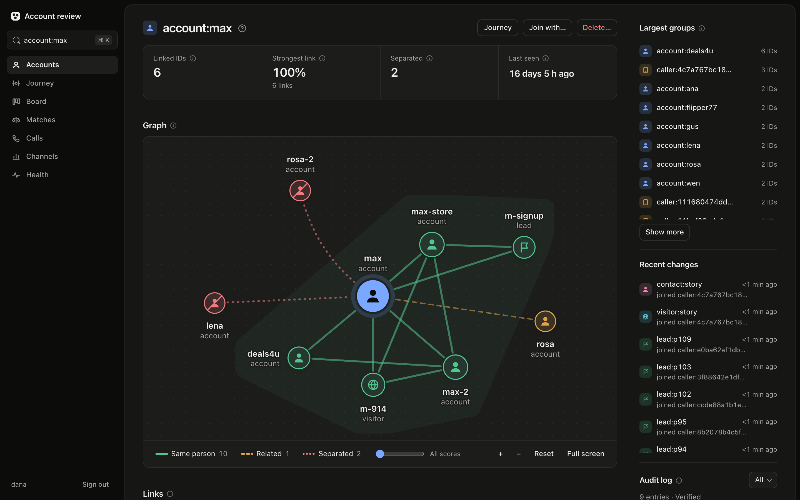
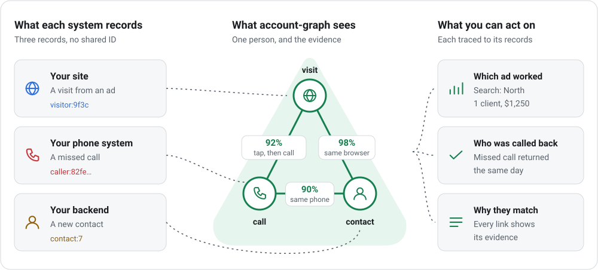
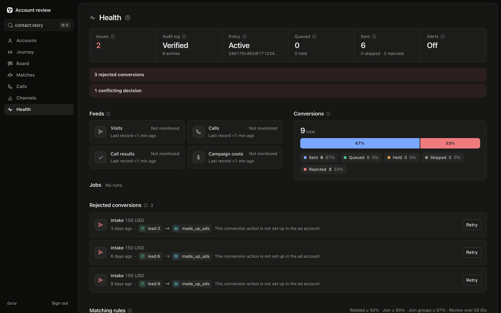
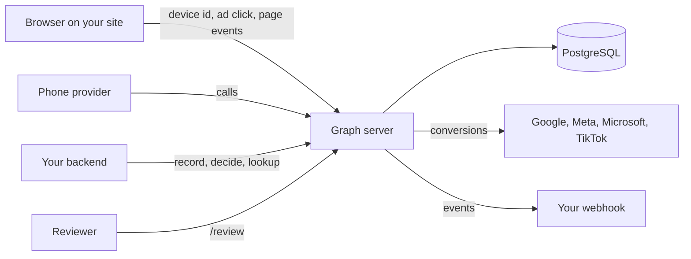

# account-graph

<p align="center">
  
  <br>
  <sub>One person's IDs in the Accounts view. All screenshots show sample data.</sub>
</p>

<p align="center">
  <b>See which ads bring in customers, which callers still need a call back, and why each record belongs to one person.</b>
</p>

Someone clicks your ad, taps your phone number, and signs up two days later. Your site, phone system and backend each record a part of that. account-graph links the parts into one person, shows why they match, and credits the sale to the ad.

<p align="center">
  <picture>
    <source media="(prefers-color-scheme: dark)" srcset="docs/images/one-person-dark.svg">
    
  </picture>
</p>

Each percentage is a score from the policy's weights, not a measured rate of correct matches.

It runs as a server beside your site, phones and backend, on PostgreSQL or in memory. The only package it can need at run time is `pg`, for PostgreSQL. It sends data only to the ad platforms, checking services and webhooks you set up, and it never calls or writes to a customer.

## Why it matters

A click, a phone call and a sale often land in different systems, under different IDs. Counted apart, they cannot answer simple questions.

| You ask | You get |
| --- | --- |
| Which ads bring customers? | Each campaign's cost beside the outcomes credited to it, even when the sale comes days later, by phone |
| Who is waiting for us? | Missed calls nobody has returned, with the ad each linked caller came from |
| Are these the same person? | A score and its reasons. Reviewers join or separate, and an audit log keeps each decision. |
| What do we tell the ad platforms? | Nothing until you choose. Then outcomes go to Google, Meta, Microsoft and TikTok. |

## Quick start

```sh
git clone https://github.com/pwngh/account-graph && cd account-graph
npm ci && npm run firm
```

A made-up law firm with two months of data, a site, and 21 scenes to play. Node 22.18 or later. Docker is optional. To set up your own, see [Getting started](docs/getting-started.md).

## Reviewer screen

Reviewers see the evidence behind every match, missed calls awaiting a callback, and the return on each campaign. These are four of its seven views. Accounts is the picture at the top, and the others are Matches and Calls.

| Board | Journey |
| --- | --- |
|  |  |
| **Channels** | **Health** |
|  |  |

## How it works

Your site, your phone system and your backend report to one server. It links what they report, shows it to reviewers, and sends the outcomes you choose to the ad platforms you set up. Your backend names the account at sign-in. The browser reports only its own device id.



### Six calls

Six calls, the same from Node and at `POST /v1/<call>`. Every write has a key of yours, so sending it again is safe.

| Call | Does |
| --- | --- |
| `record` | Writes what happened |
| `decide` | Merges, splits or mutes, and takes each back |
| `forget` | Deletes people |
| `lookup` | Says who somebody is and what brought them |
| `report` | Gives cost, results, steps, calls and texts |
| `events` | Says what happened since you last asked |

```ts
import { accountGraph } from 'account-graph'

const graph = accountGraph({ url: 'https://graph.example.org', token: process.env.GRAPH_TOKEN! })

const { results } = await graph.record({
  entries: [
    { type: 'profile', key: 'signup-42', at: 1795460000000, subject: 'account:42', facts: { device: '9f3c', email: 'pat@example.org' } },
    { type: 'conversion', key: 'enroll-42', at: 1795460000000, subject: 'account:42', stage: 'enrolled', value: 200, currency: 'USD' },
  ],
})

const { people } = await graph.lookup({ kind: 'person', subjects: ['account:42'], at: 1795460000000 })
console.log(people[0]?.arrival?.campaignId)
```

See the [HTTP API](docs/http.md) and the [library](docs/library.md).

### How a match is scored

A shared device is strong evidence and a shared IP address is weak. Clues add up, and each counts for less when more people share it. By default, 0.9 can join two records and 0.5 only relates them. See [Matching](docs/matching.md).

## Documentation

Guides are in [docs/](docs/README.md): getting started, identifying people, calls and texts, the campaign report, matching, accuracy, the HTTP API, the library, operations, providers, privacy and the demo. What changed is in the [changelog](CHANGELOG.md).

## Limitations

- No live provider account has been tried. Each endpoint tried refused an invalid key as expected. See [Providers](docs/providers.md).
- A score is a weight and not a probability, and is unmeasured on real people. On made-up people, five runs missed five, four, eight, three and one of the marks set for them. See [Accuracy](docs/accuracy.md).
- The newest qualifying visit gets all of the credit.
- `forget` leaves data at ad platforms. See [Privacy](docs/privacy.md).
- It runs no conflict check, and it keeps no consent to be called or texted.
- A graph in memory suits tests and small graphs. The package is not on npm.

## License

MIT
