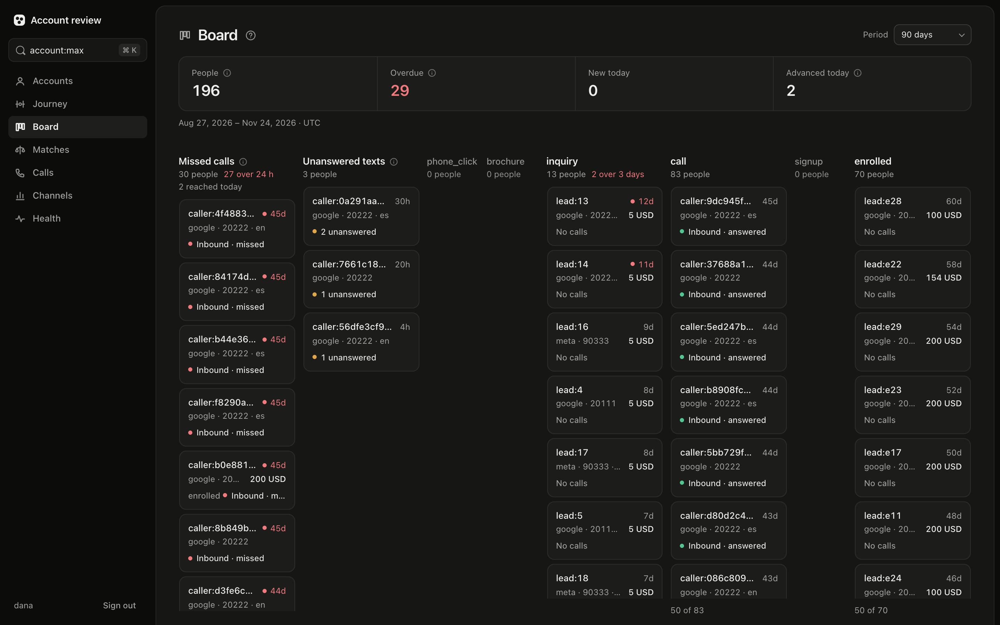
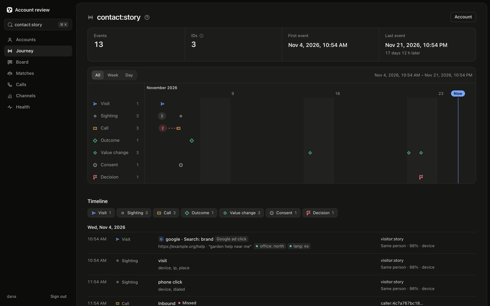
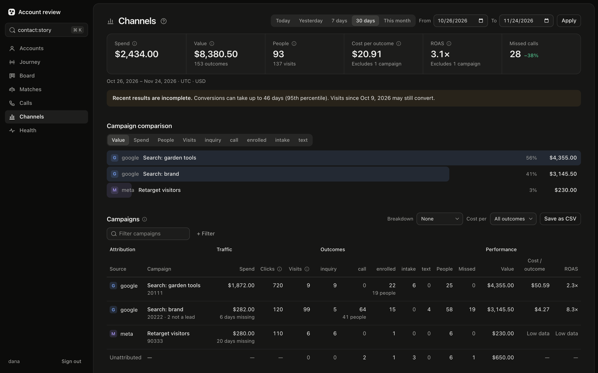
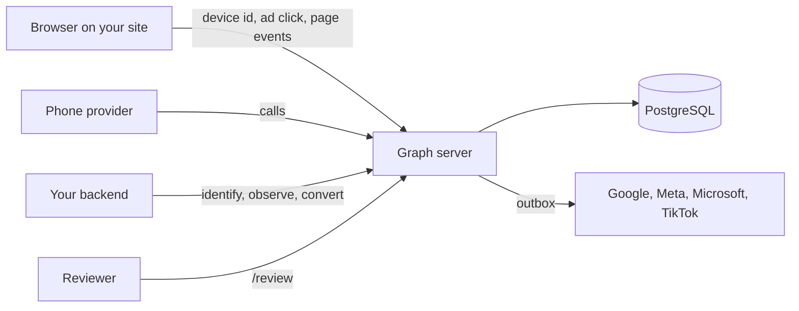

# account-graph

<p align="center">
  
  <br>
  <sub>One person's IDs in the Accounts view. All screenshots show sample data.</sub>
</p>

<p align="center">
  <b>See which ads bring in customers, which callers still need a call back, and why each record belongs to one person.</b>
</p>

<p align="center">
  <a href="#what-it-does">What it does</a> ·
  <a href="#why-it-matters">Why it matters</a> ·
  <a href="#quick-start">Quick start</a> ·
  <a href="#how-it-works">How it works</a> ·
  <a href="#documentation">Documentation</a> ·
  <a href="#limitations">Limitations</a>
</p>

## What it does

account-graph links the visits, calls, accounts and records that belong to one person, and attributes outcomes to the ads that produced them.

Someone clicks your ad, taps your phone number, and signs up two days later. Your site, phone system and backend each record a part of that. account-graph puts the parts together and shows why they match.

<p align="center">
  <picture>
    <source media="(prefers-color-scheme: dark)" srcset="docs/images/one-person-dark.svg">
    
  </picture>
</p>

Here is the same story, record by record:

| When | What happened | What account-graph does |
| --- | --- | --- |
| Mon 09:00 | They arrive from a search ad | Starts a visitor and keeps the ad click |
| Mon 09:04 | They call, and nobody answers | Links the call at 92%, awaiting callback |
| Mon 14:00 | Your team calls back | Marks the missed call returned |
| Wednesday | They sign up in that browser | Links the contact at 98% and 90% |
| Thursday | They pay $1,250 | Credits $1,250 to the campaign |

The call is linked by the tap on your number. The contact is linked to the visitor at 98% by the device, and to the caller at 90% by the mobile number they called from. Each percentage is a score from the policy's weights. It is not a measured rate of correct matches. See [Matching](docs/deciding.md).

It runs as a server beside your site, phone system and backend. Reviewers work in a built-in screen that shows the evidence behind every match, missed calls awaiting a callback, and the return on each campaign.

## Why it matters

A click, a phone call and a sale often land in different systems, under different IDs. Counted apart, they cannot answer simple questions.

| The question | On its own | With account-graph |
| --- | --- | --- |
| **Which ads bring customers?** | An ad account counts clicks. The sale may come days later, by phone. | Each campaign's cost sits beside the outcomes and value credited to it. |
| **Who is waiting for us?** | A call log lists calls. One person can be in it many times. | A missed call you can return waits until the caller is reached, or the call is marked as not a lead. A linked caller shows the ad they came from. |
| **Are these the same person?** | A shared phone or address can mean a person, a family or an office. | Each link has a score and its reasons. Reviewers join or separate people, and an audit log keeps each decision. |
| **What do we tell the ad platforms?** | Often only the click. A call or a later sale happens elsewhere. | Outcomes you give a conversion action go to the platforms you set up: Google, Meta, Microsoft and TikTok. At Google, a value can be corrected later. |

> [!NOTE]
> The server sends data to the ad platforms and webhooks you configure. It places no calls, assigns no work and sends no messages to customers.

## Who it is for

| If you | You get | Start with |
| --- | --- | --- |
| Run the business | One view of what advertising costs and what it returns | [Demo](docs/demo.md) |
| Buy the ads | Cost per outcome and ROAS by campaign, with outcomes split by office, language, hour or weekday | [Campaign report](docs/report.md) |
| Answer the phones | A board of missed calls and people by step | [Events and calls](docs/calls.md) |
| Review matches | The evidence for each link, and joins and separations you can undo | [Matching](docs/deciding.md) |
| Build and run it | A server, an HTTP API and a Node library, with PostgreSQL or in-memory storage | [Operations](docs/operations.md), [HTTP API](docs/http.md) |
| Look after privacy | What is stored, what is sent, and how to delete it | [Privacy](docs/privacy.md) |

## Quick start

Requires Node 22.18 or later. Docker is optional and provides PostgreSQL; without it the demo runs in memory.

```sh
git clone https://github.com/pwngh/account-graph && cd account-graph
npm ci && npm run firm
```

This starts a sample law firm with two months of data: the server, a bilingual site, and a stage with 21 scenes. Press Ctrl-C to stop it and delete its data. See [Demo](docs/demo.md) for its scenes.

### Example site

```sh
docker compose up --build        # the server on :8080, and its database
node examples/site.ts            # in a second terminal: an example site on :3000
```

1. Open <http://localhost:3000/?gclid=demo-click&utm_id=20111> and sign up with any email address.
2. The page shows the attributed ad click and its confidence, 98%.
3. Open <http://localhost:8080/review>, sign in with the token `change-me-review-token`, and open the account. **Channels** shows the signup under its campaign.

To use another port, run `GRAPH_PORT=8090 docker compose up --build` and `GRAPH_URL=http://localhost:8090 node examples/site.ts`.

## Reviewer screen

Four of its seven views. Accounts is the picture at the top, and the others are Matches and Calls.

| Board | Journey |
| --- | --- |
|  |  |
| **Channels** | **Health** |
|  |  |

## How it works

Three sources report to one server. It links what they report, shows it to reviewers, and sends the outcomes you choose to the ad platforms you set up.



1. The browser script reports a device id, the ad click and page events.
2. Your phone provider and backend report calls, sign-ins, outcomes and costs.
3. The server links identifiers into people and attributes outcomes to visits.
4. The outbox sends conversions to the configured ad platforms.

Your backend names the account at sign-in. The browser reports only its own device id.

### How a match is scored

A shared device id is strong evidence, and a shared IP address is weak. Clues add up, and each counts for less when more people share it.

Each shared identifier contributes evidence: the weight of its kind, reduced by how many subjects share it and by the time between sightings. Evidence combines as `1 − Π(1 − evidence)`.

By default, pairs at 0.9 can join and pairs at 0.5 are related. Clustering rules can hold a strong pair apart: a separation, or a single weak link between two groups. See [Matching](docs/deciding.md).

| Two records share | Evidence | Score | Result |
| --- | --- | --- | --- |
| A browser, by its device id | 0.98 | 0.98 | Can join |
| A mobile or landline number | 0.90 | 0.90 | Can join |
| A postal address and an IP address | 0.60, 0.30 | 0.72 | Related |
| An address, an IP address and a browser hash | 0.60, 0.30, 0.50 | 0.86 | Related |

The last two could be one person or one household. With only this evidence, they are related and do not join on their own. These rows use the default weights, with two records per identifier and no time between sightings.

### Terms

| Term | Definition |
| --- | --- |
| Subject | A person, account or device that has an ID in one of your systems |
| Identifier | A value that helps recognize a subject, such as an email or device ID |
| Sighting | An observation of a subject with an identifier at a point in time |
| Link | Two subjects that share identifiers, with a match score and evidence |
| Cluster | The linked subjects that are resolved to one person |
| Visit | A marketing touchpoint: an arrival from an ad click or a campaign |
| Outcome | A business event that is counted, such as an inquiry or a sale |
| Conversion | An outcome reported to an ad platform |
| Decision | A recorded choice to join, separate or ignore, kept in the audit log |

A subject is written `type:id`, such as `account:42`, and an identifier `kind:value`, such as `device:9f3c`. A match score is from 0 to 1. The reviewer screen calls a subject an ID, and the API calls a visit a `touch`. Links, clusters and scores are computed from sightings.

## Features

| Area | Capability |
| --- | --- |
| Identity | Scored links with their evidence, clusters that can be split, and an audit log |
| Calls and texts | Call results, callbacks, unanswered texts, and optional tracking numbers |
| Attribution | Spend, cost per outcome and ROAS by campaign, with five breakdowns |
| Conversions | An outbox for Google, Meta, Microsoft and TikTok, with retries |
| Reviewer screen | Accounts, Journey, Board, Matches, Calls, Channels and Health |
| Privacy | Hashed emails, phones and addresses, consent history and deletion |
| Operations | Feed monitoring, webhook alerts, opening hours and PostgreSQL storage |

Outcomes break down by the office advertised, the office that served, language, hour or weekday. Conversions are batched, and a value can be restated at Google. Storage can also be in memory. The only runtime dependency is `pg`, for PostgreSQL.

## Installation

Start the server and its database with your own secrets. Generate each one with `openssl rand -hex 32`.

```sh
export GRAPH_TOKEN=…             # your backend sends the same one
ORIGINS=https://www.example.org REVIEW_TOKENS='{"dana":"…"}' LINK_SECRET=… docker compose up --build
```

`ORIGINS` lists the sites allowed to report. [Operations](docs/operations.md) covers every setting.

Add the script to each page:

```html
<script type="module" src="https://graph.example.org/collect.js"></script>
```

Identify the person when they sign in or sign up:

```sh
curl -X POST https://graph.example.org/identify \
  -H "authorization: Bearer $GRAPH_TOKEN" \
  -d '{"subject":"account:42","event":"signup","device":"9f3c…","email":"pat@example.org"}'
```

The server normalizes and hashes the email, phone and postal address. `device` is the `ag_device` cookie set by the script. The response lists the subjects whose cluster changed.

## Documentation

**Run**

- [Operations](docs/operations.md): setup, Docker, the script tag, tokens, monitoring and environment variables
- [Providers](docs/providers.md): credentials for Fingerprint, MaxMind, Google, Meta, Microsoft, TikTok, Twilio and Smarty
- [HTTP API](docs/http.md): routes, authentication and responses
- [Privacy](docs/privacy.md): stored data, data sent, deletion and consent

**Use**

- [Campaign report](docs/report.md): costs, outcomes, attribution and breakdowns
- [Events and calls](docs/calls.md): page events, call results, callbacks and tracking numbers
- [Text messages](docs/texts.md): texts tied to a visit by a code or a tap, and the ones nobody has answered
- [Identify](docs/identify.md): reporting who a person is, hosted forms and filters
- [Signed links](docs/links.md): personal links and cross-site visitors

**Extend**

- [Pilot](docs/pilot.md): a trial on your own data, with nothing sent to ad platforms
- [Matching](docs/deciding.md): scores, weights, clusters and policy
- [Accuracy](docs/accuracy.md): who is joined, rightly and wrongly, over made-up people
- [Presets](docs/presets.md): a policy for contacts entered by staff
- [Library](docs/library.md): using the graph from Node
- [Performance](docs/performance.md): measured speeds and sizes
- [Changelog](CHANGELOG.md)

## Tools

| Command | Purpose |
| --- | --- |
| `npm run firm` | Sample firm with a stage for presenting |
| `npm run review` | Reviewer screen with sample data (`tools/review-demo.ts`) |
| `examples/site.ts` | Two-page site with the script tag and a signup form |
| `examples/call-tracking.ts` | Takes a call tracking webhook and posts the call |
| `tools/browser-check.ts` | Runs `collect`, the server and the outbox against a browser |
| `npm run live-check` | Calls each provider endpoint and prints its response (`tools/live-check.ts`) |
| `tools/replay.ts` | Replays an export of past traffic and compares attribution |
| `tools/labels.ts` | Measures matching against a CSV of checked pairs |
| `tools/costs.ts` | Sends a CSV of campaign costs to a server |
| `tools/export.ts` | Writes edges, flows or cluster labels as CSV |

## Verification

- The shared test suite runs on the memory store and PostgreSQL 16, locally and in CI. It includes a fuzz test of observations, decisions, deletions and transfers, and six concurrent outbox workers.
- The Docker image, the example site, ad click attribution, signed links, cross-site visitors and tap-to-call matching were exercised end to end in Chrome.
- The reviewer screen and the `HttpOnly` device cookie were exercised in Chrome under their production headers.
- A database created before an upgrade was upgraded by starting the server.
- The hardware id was exercised on macOS and Linux.
- The endpoints of Fingerprint, MaxMind, Google (token service, Data Manager, Ads reporting), Meta (conversions and cost reports), Microsoft (Advertising and token service), TikTok, Twilio Lookup and Smarty each returned the expected response to an invalid key.
- The Twilio signature check reproduces the example in Twilio's webhook security documentation.

## Limitations

**Untested**

- Requests with live provider credentials: Fingerprint and MaxMind lookups, token exchange, conversion uploads, cost reports, Twilio line lookup and Smarty address checks. Run `npm run live-check` with your keys.
- Incoming Twilio calls and delivery to a live alert webhook.
- TikTok is excluded from `npm run live-check`, because any call records an event.
- The two Fingerprint browser loaders, the Windows hardware id, and the server-set cookie in Safari.
- Microsoft does not document email normalization. The server lowercases and trims.

**Matching**

- A score is a model's, uncalibrated as a probability. On made-up people, one run missed five of the marks set for it: see [Accuracy](docs/accuracy.md). It is unmeasured on real people.
- Kinds count as independent evidence unless the policy groups them. The default policy has no groups.
- Matches covers subjects in the newest 10,000 sightings.
- Multiple separations in one component are resolved one at a time, which can cut more links than necessary.
- Separations from your own systems are applied as received. They do not replace a conflict check.
- Subject search matches the start of an id and reads the subject table.
- Signed links identify the recipient. A forwarded link can link another browser to that person. See [Signed links](docs/links.md).
- Postal address checks cover the United States.
- Names corroborate other evidence, and only under a policy that uses them.

**Calls**

- Without call results, a call is counted by its length, which time in a queue can reach.
- A tracking number identifies a visitor while it is assigned to them. A call after reassignment is linked to the new holder, or to none.
- Without a tap or a tracking number, a call is attributed to the channel of its number.
- Reported returns and not-a-lead marks are applied as received.
- Opening hours are one weekly schedule and a list of closed days for the whole organization.

**Attribution and reporting**

- The newest qualifying visit receives the whole outcome. The report is computed on request.
- A day without a cost row counts as missing, including for a paused campaign.
- Call outcomes are correlations. The one-day landmark removes one source of bias.
- Platform-reported conversions are shown as received, and no live ones have been read.
- Refunds and write-offs are counted when a value change includes a `kind`. Platforms receive the new value without the reason.
- Platforms that cannot restate keep a conversion whose call turned out missed or not a lead.
- Meta's browser id is sent only with a visit that has a Meta click, on sites that run the Meta pixel.
- A Journey reads up to 60 subjects per person. It stores conversion status without the send time.
- The Board lists people with a step or a call in its period.

**Privacy and operations**

- `forget` leaves data at ad platforms. `POST /forget` can list it, and `FORGET_ADS` or `retract` asks Microsoft, the one supported platform, to retract them. Microsoft does not state that a retraction deletes data. No live request has been made.
- Consent records cover advertising, and exclude consent to be contacted.
- Each page view that reports consent adds a history row. `prune` deletes superseded rows.
- The `/collect` rate limit is per server process.
- A stale feed is detected by the absence of records. Incorrect records are not detected.
- `asOf` excludes deleted subjects and pruned sightings. It runs in memory and exceeded Node's default limit at 10 million edges; `rebuild` and `verify` completed.
- Flows and rings use running totals per pair, without the order of transfers.
- The memory store does not roll back a failed write.
- The package is not published to npm. Install by cloning the repository.

## License

MIT
