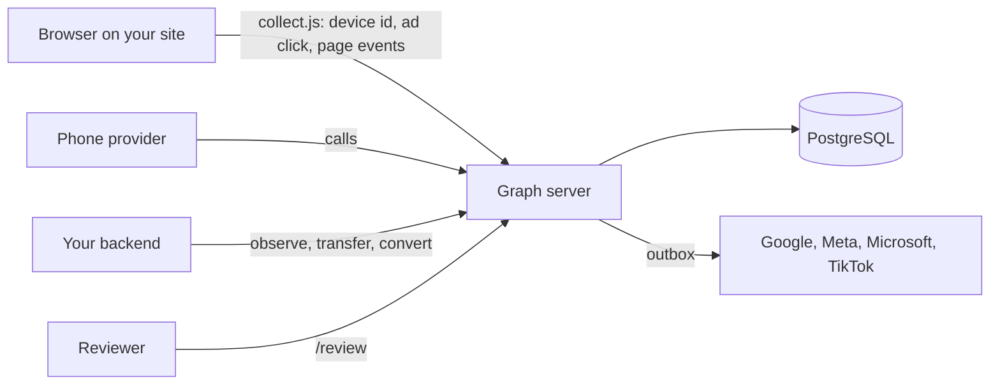

# account-graph

Works out which accounts, leads, and anonymous visitors are the same person, and traces a sign-up or sale back to the ad click that started it.

It runs as a server beside your sites. Each page reports its visits with one script tag, your backend says who a visitor turned out to be, and the server answers with who else that is.

## Try it in five minutes

You need Docker and Node 22.18 or later. If port 8080 is taken, start with `GRAPH_PORT=8090 docker compose up --build` and `GRAPH_URL=http://localhost:8090 node examples/site.ts`.

```sh
git clone https://github.com/pwngh/account-graph && cd account-graph
docker compose up --build        # the server on :8080, and its database
node examples/site.ts            # in a second terminal: an example site on :3000
```

1. Open <http://localhost:3000/?gclid=demo-click&utm_id=20111> and sign up with any email.
2. The page answers: *The graph server credits the ad click demo-click at 98% confidence.*
3. Open <http://localhost:8080/review>, enter the token `change-me-review-token`, and open the account. It is joined to the visitor who clicked the ad.

That is the whole loop: a visit, a sign-up, an answer, and a screen for the people who check it.

The same example shows the rest. Press **Channels** on the reviewer screen to see the sign-up under its campaign. On the example site, *See an email* opens a link that names its contact, *Our other site* carries you to a second host name as the same visitor, and *Who does the graph think this browser is?* shows the result.

## How the pieces fit



The browser never names an account. It only says "this device, arriving from this ad click". Your backend names the account at sign-in, with whatever it saw: the device cookie, an email, a machine id. The server joins the two when the evidence is strong enough, and the outbox tells each ad platform which click earned the conversion.

## On your own site

Add the script tag to every page:

```html
<script type="module" src="https://graph.example.org/collect.js"></script>
```

When someone signs in or signs up, tell the server from your backend:

```sh
curl -X POST https://graph.example.org/observe \
  -H "authorization: Bearer $GRAPH_TOKEN" \
  -d '{"subject":"account:42","identifiers":["device:9f3c…"],"at":1795460000000,"event":"signup"}'
```

The `device:` value is the `ag_device` cookie the script set, which your backend reads from the request. The answer lists every subject whose cluster just changed.

## The words it uses

| Word | Meaning |
| --- | --- |
| Subject | Anything with an identity: `account:42`, `visitor:9f3c`. |
| Identifier | Something a subject was seen with, written `kind:value`: `device:9f3c`, `email:…`, `ip:203.0.113.9`. |
| Sighting | One time a subject was seen with an identifier. Sightings are the record; everything else is worked out from them. |
| Link | Two subjects that share identifiers, with a score from 0 to 1 and the reasons for it. |
| Cluster | The subjects the graph treats as one person. |
| Touch | An arrival from an ad click or a campaign. |
| Outcome | Something a person did that you count: an inquiry, a sign-up, a sale. |
| Cost | What an ad platform charged for one campaign on one day. |
| Decision | A reviewer's call: join these two, keep these two apart, stop linking through this identifier. |

## What it does

- **Scored links with reasons.** Every link says which shared identifiers produced it and how much each counted.
- **Clusters that can split.** Clusters are derived from the record, so a bad identifier can be ignored and a person can be forgotten, and the clusters come apart correctly.
- **No chain merges.** One weak link can add an account to a group but cannot join two groups on its own.
- **Reviewer decisions.** Join two subjects, keep two apart, or mute an identifier. Each decision is recorded with who and why, and sealed so the record cannot be quietly edited.
- **Money flows.** Trades and transfers between accounts are reported with how the two are tied by identity, and value that goes round in a circle is found, so collusion shows up.
- **Attribution with confidence.** A conversion lists every touch that could have led to it and credits one only when the chain of links is strong.
- **A report of cost against outcomes.** Campaign costs are read from Google Ads and Meta, or posted, and set beside the inquiries, sign-ups and sales each campaign's visitors produced. A cost per outcome counts only days whose cost is known, and is withheld when too few are. People are counted beside outcomes, and recent days are marked as still filling.
- **Broken down your way.** By the office an ad was for, the office that served, language, hour or weekday, with what was not recorded always shown. Costs are never split by guesswork.
- **Steps with a value.** Name your steps once (inquiry 5, call 10, client 200) and every outcome, page event and call takes its value and its ad platform action from its step.
- **Alerts.** A conversion that fails for good, an outbox that cannot run, or costs that cannot be read are posted to a Slack-style webhook. So is a feed that has gone quiet, and a missed caller from an ad whom nobody has rung back. An alert that does not arrive is kept until it does.
- **Page events and phone calls.** The script tag reports taps and marked clicks, and a call that follows a tap is tied to the visitor who tapped, so calls land under the ad click that produced them.
- **Calls that were really answered.** A queue hang-up is not an answer. Your phone system reports how each call went, and a call can be held, uncounted and unsent, until it does. Each missed call says whether it was returned, and after how long, and a Calls view lists the ones still open.
- **Links that name a person.** A signed link in an email or text ties the browser that opens it to the person it was sent to, and a visitor stays one visitor across your sites.
- **One call to say who someone is.** Send an email, phone, address and device as they are; the server hashes them, checks the address with the postal service, and counts a throwaway phone number for less.
- **Real integrations.** Fingerprint, the operating system's machine id, MaxMind, Twilio, Smarty, the Google tag's cookies, the cost reports of Google Ads and Meta, and the conversion APIs of Google, Meta, Microsoft, and TikTok.
- **An outbox for conversions.** Outcomes are recorded once, sent in batches to each ad platform, retried with backoff, and never sent by two workers at once. Failed ones can be listed and retried.
- **Your own staff left out.** Visits from your networks, or from a browser marked by a signed link, are dropped and counted.
- **Consent.** Every answer, from a browser's opt-out signal, a banner or your backend, is kept, and the one given last is honoured before anything goes to an ad platform.
- **A write queue.** Observations that arrive together are written together, four times faster on PostgreSQL.
- **Two stores, one suite.** Memory and PostgreSQL pass the same tests, including a fuzz test that checks stored clusters against a full recompute after every operation.
- **No runtime dependencies.** `pg` is needed only for the PostgreSQL store.


## Where to read next

**To run it**

- [Running the server](docs/operations.md): the start command, Docker, the script tag, tokens, every variable.
- [Setting up the providers](docs/providers.md): where to get keys for Fingerprint, MaxMind, Google, Meta, Microsoft and TikTok.
- [The HTTP routes](docs/http.md): every route, which token opens it, and what it answers.
- [What each campaign cost and brought in](docs/report.md): the three things the report needs, and how to read it.
- [Page events and phone calls](docs/calls.md): what the script tag reports from a page, and how a call finds its visitor.
- [Links that name a person](docs/links.md): signed links for email and text, and one visitor across several sites.
- [Telling the server who someone is](docs/identify.md): one call with plain facts, forms that post elsewhere, and what is filtered out.

**To understand it**

- [How it decides](docs/deciding.md): the score, the weights and what they rest on, how links become clusters, and when to change a setting.
- [Presets](docs/presets.md): a policy for contacts entered by staff, and what to do about shared phones.

**To build on it**

- [Using it as a library](docs/library.md): the same graph as functions in your own Node program, with the memory or PostgreSQL store.
- [CHANGELOG.md](CHANGELOG.md): what the first release contains.

## Speed

On an M-series laptop, with a 20,000-account synthetic workload:

| Store | One at a time | Through the write queue | `links()` |
| --- | --- | --- | --- |
| Memory | 33,000 observations/s | 17,000/s | 0.02 ms |
| PostgreSQL 16, local, fsync on | 930 observations/s | 4,200/s | 0.42 ms |

PostgreSQL writes take one advisory lock, so they run one at a time; the write queue is how many callers share one write. Run `npm run bench` for your own numbers.

## Tools

- `examples/site.ts` is a two-page site with the script tag and a sign-up.
- `tools/review-demo.ts` serves the reviewer screen over made-up data.
- `tools/browser-check.ts` runs `collect`, the server, and the outbox against a real browser.
- `tools/live-check.ts` calls each provider's real endpoint, with your keys when they are set, and prints how it answered.
- `tools/replay.ts` replays an export of your own past traffic and compares attribution with what was sent.
- `tools/costs.ts` sends a CSV of campaign costs to a running server.
- `tools/export.ts` writes edges, flows, or cluster labels as CSV for an analytics engine.


## What has run for real

- Every test runs on memory and on PostgreSQL 16, locally and in CI, including a fuzz test that mixes observations, reviewer decisions, deletions, and transfers, and six outbox workers at once.
- The image was built and `docker compose up` brought up the server and its database. With the example site pointed at it, a visit with an ad click followed by a sign-up was credited in Chrome, and the reviewer screen served from the container showed the account joined to its visitor. Against the same container, a signed link tied a browser to its contact, a link to the example's second host name carried the visitor across, and a call posted after a tap was tied to that visitor and valued by its step.
- The script tag ran in Chrome from a different origin than the page that loaded it.
- With `cookie: true` the device cookie was set by the server, invisible to script, and the same on the next visit.
- The reviewer screen ran in Chrome under its content policy: a cluster opened, two accounts were kept apart with a reason, the cluster split, and the decision appeared on the record.
- The channel report ran in Chrome: a sign-up on the example site, arriving with a campaign id, appeared on that campaign's line beside its cost.
- A tap on a phone link in Chrome, followed by a call posted for that number, joined the caller to the browser's visitor and counted the call under the visitor's campaign.
- A signed link opened in Chrome tied the browser to its contact and left the address bar clean. Following a link to the example under a second host name joined that host's visitor to the first.
- With the device cookie deleted, the example's sign-up form still carried the device id in a hidden field the script added, and the sign-up was credited to its ad click.
- A database made before an upgrade was brought up to date by starting the server.
- The hardware id ran on macOS and, in CI, on Linux.
- The real endpoints of Fingerprint, MaxMind, Google's token service, Google's Data Manager, Google Ads reporting, Meta's conversions and its cost reports, Microsoft Advertising, Microsoft's token service, TikTok, Twilio Lookup, and Smarty each answered an invalid key the way the code expects.
- The check of Twilio's signature reproduces the example on Twilio's own webhook security page.

## Limits

- No request has been made with real credentials. A successful Fingerprint lookup, MaxMind answer, token from Google or Microsoft, upload to any ad platform, cost report from Google Ads or Meta, Twilio line lookup, and Smarty address check are all untested. `npm run live-check` is how to run them with yours.
- No real phone call has arrived from Twilio, and no alert has been posted to a real webhook.
- A day a platform sends no cost row for counts as missing, although a paused campaign looks the same.
- The report credits the newest strong touch with the whole outcome, and is worked out each time it is asked for.
- Without call results, a call is counted by its length, which a queue hang-up can reach. Platforms that cannot restate keep a conversion sent for a call that turned out missed.
- A quiet feed is noticed by hours without a record, so a feed that still sends something wrong is not.
- Tracking numbers are one per channel. There is no pool that gives each visitor a number of their own.
- A signed link is a key: forwarded to a stranger's browser, it ties that browser to the person it names. [Links](docs/links.md) says what limits that and what does not.
- Postal addresses are checked for the United States only, and names are never matched.
- TikTok keys are not exercised by `npm run live-check`, because any call would record an event.
- The two Fingerprint browser loaders have not run in a browser. They need a real key or a third-party script.
- The server-set cookie has run in Chrome only. Safari's handling is the reason it exists, and it has not run there.
- The hardware id's Windows path is untested.
- Microsoft does not document how to normalize an email before hashing it; this lowercases and trims.
- The per-address limit on `/collect` is kept in each server's memory. Several servers each allow the limit.
- Subject search matches the start of an id and reads the subject table to do it.
- `asOf` cannot bring back a forgotten subject or a pruned sighting; both are gone from every past.
- A separation between two subjects cuts the weakest links between them. With several separations in one component the cuts are made one after another, which is not always the fewest possible.
- Kinds count as independent evidence unless the policy puts them in one group. The default has no groups.
- The consent kept is about advertising. It is not a record of consent to be contacted.
- Each page view adds a row to the consent history when the page reports an answer. `prune` deletes the ones that no longer stand.
- Pairs kept apart by your own systems are only as right as those systems. One person entered on both sides is split, and keeping two apart is not a conflict check.
- Flows are kept as running totals per pair, not as a ledger.
- `rebuild`, `verify`, and `asOf` load every edge into memory.
- The memory store does not roll back a failed write.
- Not published to npm. Until it is, installing means cloning.

## License

MIT
